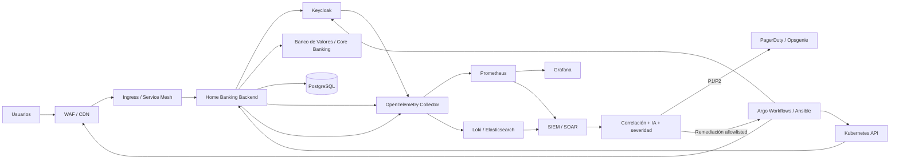

# Centro de Comando de Seguridad y Resiliencia Operativa

## Objetivo

Single Pane of Glass para el usuario administrador de Home Banking. El panel debe responder tres preguntas: ¿está sano el sistema?, ¿hay un incidente?, ¿qué remediación controlada corresponde?

El panel administrativo nunca ejecuta shell, Docker, kubectl ni cambios directos sobre infraestructura. Las acciones disruptivas se delegan a un orquestador SOAR/Argo/Ansible con allowlist, doble control, auditoría y límites de blast radius.

## Arquitectura objetivo

- OpenTelemetry Collector: traces, métricas y logs.
- Prometheus: métricas y alertas técnicas.
- Grafana: dashboards SRE.
- Loki o Elasticsearch: logs estructurados.
- SIEM/SOAR: correlación de seguridad y playbooks.
- Kubernetes: despliegue, probes, HPA, PDB y rolling updates.
- Istio/Envoy: mTLS, circuit breakers, retries con límites y bulkheads.
- Vault + HSM: secretos y material criptográfico.
- Keycloak: identidad, sesiones y MFA/passkeys.
- WAF/CDN: protección DDoS y rate limiting.
- PagerDuty/Opsgenie: on-call y escalamiento.

## Flujo de detección y recuperación



## SLIs / SLOs iniciales

| Servicio | SLI | SLO objetivo |
|---|---|---|
| Login SSO | éxito de autenticación | >= 99.99% |
| API Home Banking | requests 2xx/4xx esperables | >= 99.99% |
| API Home Banking | p95 | < 300 ms sin dependencia bancaria |
| PostgreSQL operativa | p95 de consultas críticas | < 50 ms |
| PostgreSQL | errores de conexión | < 0.01% |
| Banco de Valores | disponibilidad de consulta | >= 99.9%, sujeto a SLA externo |
| Transferencias | duplicados | 0 |
| Auditoría | pérdida de eventos | 0 |
| ZAP baseline | ejecución nocturna | >= 99% de noches |

No se debe prometer 99.999% hasta medir el sistema completo, incluyendo SSO, red, base, banco externo, WAF y operación.

## Health checks

- Startup: proceso iniciado y configuración válida.
- Readiness: PostgreSQL operativa e histórica accesibles; dependencias externas críticas solo cuando su ausencia realmente impida servir tráfico.
- Liveness: proceso responde sin bloqueo.
- Synthetic transaction externo: WAF + SSO + API + dependencia bancaria.
- Certificados: días restantes y cadena válida.
- Vault: seal status, lease renewal y expiración.
- HSM: conectividad, partición, capacidad y estado de claves.
- Keycloak: disponibilidad, errores de token y tasa de login fallido.

Una dependencia bancaria caída no debe convertir automáticamente todos los pods en NotReady: el patrón correcto es degradación elegante y circuit breaker.

## Self-healing

1. Kubernetes reinicia contenedores con liveness failure.
2. Readiness elimina instancias degradadas del balanceo.
3. HPA escala por CPU/memoria y, preferentemente, por métricas de negocio como requests en cola.
4. PDB evita perder todas las réplicas durante mantenimiento.
5. Argo/Ansible ejecuta únicamente runbooks versionados y aprobados.
6. Failover multi-región requiere consenso, RPO/RTO definidos y pruebas periódicas; nunca debe improvisarse desde el navegador.

## Contención SOAR

### DDoS / abuso
- WAF rate limit.
- Challenge o bloqueo temporal por IP/ASN cuando exista evidencia suficiente.
- Escalamiento al proveedor DDoS.
- Nunca bloquear una red completa por una única señal.

### Fuerza bruta
- Detectar picos de login fallido por usuario/IP/ASN.
- Rate limit progresivo.
- Revocar sesiones afectadas cuando el incidente lo justifique.
- Forzar MFA adicional para grupos de riesgo.

### Posible exfiltración
- Reducir o bloquear temporalmente el endpoint afectado.
- Revocar tokens/sesiones comprometidos.
- Preservar evidencia en SIEM.
- El SOAR nunca debe destruir evidencia automáticamente.

## Centro de Comando del administrador

El panel debe mostrar: estado global HEALTHY/DEGRADED/CRITICAL; latencia PostgreSQL; saturación de pools; backend; Keycloak; Banco de Valores; certificados; Vault/HSM; autenticaciones; errores API; transferencias inciertas; alertas SIEM; último ZAP baseline; incidentes; SLO burn rate.

Acciones visibles: activar modo solo consultas, aislar Banco de Valores, reiniciar backend/jobs, escalar backend, recuperar operaciones ENVIANDO y failover asistido. Cada acción debe generar correlation-id, usuario, motivo, aprobación y resultado.

## Runbook de ejemplo

```yaml
apiVersion: autoscaling/v2
kind: HorizontalPodAutoscaler
metadata:
  name: home-banking-backend
spec:
  scaleTargetRef:
    apiVersion: apps/v1
    kind: Deployment
    name: home-banking-backend
  minReplicas: 3
  maxReplicas: 12
  behavior:
    scaleUp:
      stabilizationWindowSeconds: 30
    scaleDown:
      stabilizationWindowSeconds: 300
  metrics:
    - type: Resource
      resource:
        name: cpu
        target:
          type: Utilization
          averageUtilization: 65
```

Es una referencia para Kubernetes; no debe desplegarse en producción sin adaptar recursos, métricas, namespace, PDB, NetworkPolicies, Secrets y estrategia de disponibilidad.

## Estado aplicado al Home Banking actual

El repositorio ya dispone de `/api/health`, telemetría de latencia HTTP/DB, pools PostgreSQL y baseline nocturno ZAP contra staging. También se incorporó `backend/src/routes/centro-comando.js` para preparar el estado administrativo.

La ejecución de remediaciones queda deliberadamente separada hasta que exista la infraestructura Zero Trust/SOAR. Esto evita dar a una sesión web poder directo para ejecutar comandos de infraestructura o provocar un failover accidental.

## Roadmap

Fase 1: dashboard admin + métricas + health checks.
Fase 2: OpenTelemetry + Prometheus + Grafana + Loki.
Fase 3: SIEM/SOAR + PagerDuty/Opsgenie.
Fase 4: Kubernetes + Istio + NetworkPolicies.
Fase 5: Vault + HSM + MFA/passkeys.
Fase 6: runbooks de auto-remediación con doble control.
Fase 7: multi-región y failover probado.
Fase 8: chaos engineering y simulacros DR.

## Regla de oro

Ningún mecanismo de self-healing puede reenviar automáticamente una transferencia financiera incierta. Para estados inciertos se debe conciliar primero con el banco; el sistema actual mantiene esa protección.
