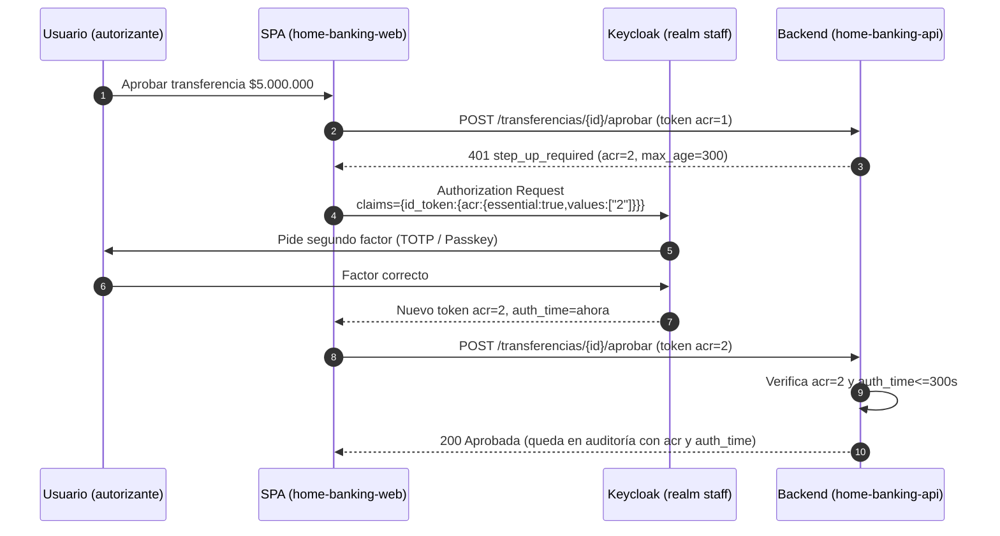

# Arquitectura IAM con Keycloak — Home Banking VALO

Propuesta de arquitectura, configuración y estrategia de integración de Keycloak
como proveedor de identidad (IdP) de nivel bancario para el Home Banking VALO.
Cubre autenticación, autorización fina, ciclo de vida de sesiones, seguridad
avanzada/Open Banking y despliegue en alta disponibilidad, con foco en
cumplimiento (PCI-DSS, GDPR/LGPD) y seguridad financiera.

> **Importante — alcance real en esta aplicación.** Hoy Keycloak autentica al
> **personal del banco** (realm `staff`: operador, autorizante, auditor,
> administrador de seguridad). Los **clientes/empresas no son usuarios del IdP**:
> reciben correos (extractos y alertas) pero no inician sesión en Keycloak. Por
> eso el documento separa, en cada módulo y en la tabla final, lo que **aplica
> directo al personal**, lo que es **parcial** y lo que queda **fuera de alcance**
> salvo que se agregue un portal de clientes. No se vende como implementado lo que
> no encaja en el diseño actual.

## 0. Mapa de aplicabilidad

| Capacidad | Estado en esta app | Por qué |
|---|---|---|
| Brute force, bloqueo por intentos | **Aplica** | Realm ya lo tiene; se endurece |
| Access token ultracorto + refresh rotativo con detección de reuso | **Aplica** | Personal; es config de realm + cliente |
| PKCE S256 obligatorio (SPA) | **Aplica (ya está)** | `home-banking-web` es público |
| Step-up para operaciones críticas (ACR/LoA) | **Aplica (a implementar)** | Aprobar transferencias, cambio de credenciales |
| TOTP / Passkeys (WebAuthn/FIDO2) para el personal | **Aplica** | Segundo factor del staff |
| Límite de sesiones concurrentes, logout remoto, inactividad | **Aplica** | Sesiones del personal |
| RBAC (roles) | **Aplica (ya está)** | Roles de cliente en `home-banking-api` |
| ABAC por contexto (IP, geo, horario, monto) | **Parcial** | Monto/horario se evalúan en el backend, no en el token |
| Event listener → SIEM | **Aplica** | Eventos de Keycloak + cadena de auditoría propia |
| HA multi-región (Infinispan/K8s) | **Parcial** | Hoy es Docker Compose single-node |
| eKYC / onboarding de clientes | **Fuera de alcance** | No hay IdP de clientes |
| MFA adaptativo de clientes, biometría en app | **Fuera de alcance** | No hay app de clientes |
| UMA 2.0 (delegación a cotitulares) | **Fuera de alcance** | Requiere IdP de clientes y recursos UMA |
| FAPI / Open Banking certificado, DPoP | **Fuera de alcance (hoy)** | No hay clientes de terceros ni API de Open Banking |
| User Storage SPI contra Core Banking | **Fuera de alcance (hoy)** | El personal vive en la base de Keycloak |
| Firma de transacciones / no repudio vinculada al token | **Parcial** | Se puede lograr con la cadena de auditoría + hash del token |

El resto del documento describe la arquitectura objetivo completa (incluida la que
no aplica hoy), porque sirve de hoja de ruta si en el futuro se agrega un portal
de clientes u Open Banking.

---

## 1. Autenticación y gestión de identidad

### 1.1 MFA adaptativo basado en riesgo

Jerarquía de factores, de más fuerte a más débil:

1. **Passkeys / WebAuthn (FIDO2)** — resistente a phishing, es el objetivo para el
   personal con acceso a aprobación de transferencias.
2. **TOTP** (Google/Microsoft Authenticator) — segundo factor estándar del staff.
3. **OTP por Email/SMS** — solo recuperación o respaldo; el SMS no cuenta como
   factor fuerte para operaciones de alto riesgo (SIM swapping).
4. **Biometría de la app** — solo si hubiera app de clientes (fuera de alcance).

El "adaptativo" se consigue con una **Browser Flow condicional**: el segundo factor
se pide según señales de riesgo (red nueva, dispositivo nuevo, horario atípico,
geovelocidad). En Keycloak esto se arma con *conditional subflows* y un
authenticator de riesgo (propio vía SPI, o integrando un motor externo). Para el
personal, una política realista: **TOTP/Passkey obligatorio siempre** (no es masivo,
es staff) y **step-up** encima para lo crítico.

### 1.2 Step-up authentication (autenticación reforzada)

Objetivo: no molestar en cada clic, pero exigir un factor reciente y fuerte justo
antes de una operación crítica (aprobar transferencia de alto monto, cambiar
credenciales, ver datos sensibles masivos).

Mecanismo: **ACR/LoA** (Authentication Context Class Reference / Level of
Assurance). El login normal emite `acr=1` (silver). Para operaciones críticas, el
front pide al IdP un token con `acr=2` (gold) usando `claims`/`acr_values`; Keycloak
dispara el subflow de segundo factor y, si pasa, emite un token con `acr=2` y
`auth_time` reciente. El backend **exige** `acr=2` y `auth_time` dentro de una
ventana corta (p. ej. 5 min) para esos endpoints.



Disparadores de step-up recomendados en esta app:

- **Aprobar transferencia** por encima de un umbral (monto configurable).
- **Aprobar lote** por encima de un umbral agregado.
- **Cambio de credenciales API / gestión de usuarios** (acciones del administrador).
- **Exportaciones masivas** de datos de clientes.

### 1.3 SSO y SLO

- **SSO**: un login en el realm `staff` habilita la SPA; si se suman más clientes
  internos (back-office, panel de riesgo) comparten sesión del realm.
- **SLO (Single Log-Out)**: usar **Back-Channel Logout** (OIDC) para que al cerrar
  sesión se invaliden todas las sesiones de todos los clientes, no solo la pestaña.
  Configurar `backchannel.logout.session.required=true` y la *Backchannel Logout
  URL* en cada cliente confidencial. La SPA, al ser pública, se apoya en
  `end_session_endpoint` + `post_logout_redirect_uri`.

### 1.4 Registro, onboarding (eKYC) y recuperación

- **Personal (aplica)**: alta la hace el administrador (no auto-registro:
  `registrationAllowed=false`). Credencial temporal + `UPDATE_PASSWORD` +
  enrolamiento obligatorio de TOTP/Passkey en el primer ingreso.
- **Clientes / eKYC (fuera de alcance hoy)**: si se agrega portal de clientes, el
  onboarding con verificación de identidad (documento + prueba de vida) se integra
  como un *Identity Provider* o un authenticator SPI que llama al proveedor de eKYC
  antes de crear el usuario.
- **Recuperación**: reset por email con token de un solo uso y expiración corta,
  **siempre** seguido de reconfiguración del segundo factor; nunca recuperar la
  cuenta solo con el factor de conocimiento.

---

## 2. Autorización y control de acceso fino

### 2.1 Modelo combinado RBAC + ABAC + UMA

- **RBAC (ya implementado)**: roles de cliente en `home-banking-api`
  (`operador`, `autorizante`, `auditor`, `administrador`, `transferencias:crear`,
  `transferencias:aprobar`). El backend decide por rol (`exigirRol`, `exigirCrear`,
  `exigirAprobar`) y además por **permiso por empresa** (`permiso_empresa`), que es
  ya una forma de ABAC a nivel de dato.
- **ABAC (parcial, reforzar)**: atributos de contexto (IP, geo, reputación de IP,
  tipo de dispositivo, hora, **límite transaccional** del usuario). En banca lo
  robusto es evaluar monto/horario/límite **en el backend** (donde está el dato y la
  lógica), usando el token solo para identidad + nivel de aseguramiento (`acr`). Los
  atributos "baratos" y estables (unidad, sucursal, límite diario) pueden viajar como
  *claims* vía protocol mappers; los volátiles (IP, geovelocidad) se evalúan en el
  gateway/backend.
- **UMA 2.0 (fuera de alcance hoy)**: delegación de un cliente a un cotitular o
  tercero. Requiere IdP de clientes, definir cada cuenta como *resource* y permisos
  UMA; el *Resource Server* (API) valida el *RPT*. Es la base técnica de "autorizar a
  mi contador a ver la cuenta X en modo lectura".

### 2.2 Políticas basadas en contexto

| Atributo | Dónde se evalúa | Acción |
|---|---|---|
| IP / reputación | Gateway (nginx) + backend | Bloqueo, o forzar step-up |
| Geovelocidad (login desde 2 países en minutos) | Authenticator de riesgo / SIEM | Forzar step-up o bloquear |
| Dispositivo nuevo | Browser flow condicional | Pedir segundo factor |
| Hora atípica | Backend (reglas) | Alertar / step-up |
| Límite transaccional del usuario | Backend | Rechazar o exigir doble control |

### 2.3 Scopes de mínimo privilegio

- `home-banking-web` recibe un token con **audiencia** `home-banking-api` (ya lo hace
  vía *audience mapper*) y solo los roles del usuario.
- Definir *client scopes* opcionales y pedir en cada *authorization request* solo lo
  necesario (`scope=openid profile`), evitando claims innecesarios (minimización de
  datos, GDPR). No emitir PII que el backend no use.

---

## 3. Ciclo de vida de usuarios y sesiones

### 3.1 Estrategia de tokens

- **Access token ultracorto**: 2–5 min. Minimiza la ventana de un token robado.
- **Refresh token rotativo con detección de reuso**: cada *refresh* emite un token
  nuevo e invalida el anterior (`Revoke Refresh Token = ON`, `Max Reuse = 0`). Si
  llega un refresh ya usado ⇒ se asume robo ⇒ se invalida toda la cadena (familia) y
  se fuerza re-login. Esto es **Refresh Token Rotation + reuse detection**.
- **DPoP (Demonstrating Proof-of-Possession)**: liga el token a una clave del cliente
  (sender-constrained), así un token robado no sirve sin la clave privada. Útil sobre
  todo para APIs de terceros / Open Banking; en una SPA de personal el beneficio es
  menor que el costo. Queda recomendado para la fase Open Banking.

```mermaid
sequenceDiagram
    autonumber
    participant C as Cliente (SPA/App)
    participant KC as Keycloak

    C->>KC: Login OK
    KC-->>C: AT1 (ultracorto) + RT1 (familia F, gen 1)
    Note over C,KC: AT1 expira
    C->>KC: refresh(RT1)
    KC->>KC: RT1 válido ⇒ rota
    KC-->>C: AT2 + RT2 (familia F, gen 2); RT1 revocado
    Note over C: RT1 queda en un storage comprometido
    rect rgb(255,235,235)
    C->>KC: refresh(RT1)  (reuso)
    KC->>KC: RT1 ya usado ⇒ posible robo
    KC-->>C: 400 invalid_grant + invalida familia F
    end
    C->>KC: Se fuerza re-login (con MFA)
```

### 3.2 Sesiones concurrentes y anómalas

- **Límite de sesiones activas por usuario**: authenticator *User Session Count
  Limiter* en la Browser Flow (p. ej. máx. 2 sesiones; la más vieja se cierra).
- **Invalidación remota**: Keycloak Account Console / Admin API permite listar y
  cerrar sesiones; la app puede exponer "cerrar mis otras sesiones" llamando a la
  Admin API con el service account `home-banking-admin`.
- **Detección de sesiones anómalas**: se resuelve con los *events* enviados al SIEM
  (login desde IP/país nuevo, muchas sesiones) y una acción de invalidación.

### 3.3 Inactividad y bloqueo por fuerza bruta

- **Idle timeout** de sesión (p. ej. 15 min) y **max lifespan** (p. ej. jornada
  laboral). El idle de sesión del IdP es independiente del idle de la app.
- **Brute Force Detection** (ya activo): tras N fallos, espera creciente; para banca,
  `permanentLockout=false` con espera larga + alerta al SIEM (el lockout permanente es
  un vector de DoS contra la cuenta). El *rate limiting* de pedidos lo hace además el
  gateway (nginx) y el backend por usuario.

---

## 4. Seguridad avanzada, delegación y Open Banking

> Bloque mayormente **fuera de alcance hoy** (no hay clientes de terceros ni portal de
> clientes). Se documenta como arquitectura objetivo.

### 4.1 UMA 2.0 — delegación a cotitulares/terceros

Cada cuenta es un *resource* con *scopes* (`ver-saldos`, `ver-movimientos`,
`operar`). El titular, desde su Account Console, otorga a un tercero permisos
específicos; el tercero obtiene un **RPT** que el Resource Server (API) valida. Así se
modela "mi contador ve la cuenta X en lectura, sin poder operar".

### 4.2 FAPI y PKCE

- **PKCE S256** ya es obligatorio en el cliente público (`home-banking-web`). Debe
  seguir siéndolo para cualquier cliente público nuevo.
- **FAPI (Financial-grade API)**: perfil para Open Banking. Implica clientes
  confidenciales con *mutual TLS* o *private_key_jwt*, PAR (Pushed Authorization
  Requests), `request` object firmado, y tokens sender-constrained. Keycloak soporta
  los perfiles *FAPI 1 Advanced* / *FAPI 2*. Solo tiene sentido cuando exista API de
  Open Banking.

### 4.3 Firma de transacciones / no repudio

Objetivo: prueba criptográfica de que *este* usuario autorizó *esta* operación. En
esta app se logra combinando:

- El token con `acr=2` y `auth_time` del step-up (quién y con qué factor).
- La **cadena de auditoría hash** que ya existe (`auditar`), encadenando el hash del
  evento con el `sub`, `jti`/hash del token y los datos de la operación.

Eso da no repudio a nivel aplicación. La firma criptográfica "fuerte" de cada
transacción (con clave del usuario, estilo WYSIWYS) requeriría FIDO2/CIBA y es un
paso posterior.

---

## 5. Arquitectura de despliegue, HA e integración

### 5.1 Keycloak en Kubernetes con Infinispan

- Keycloak con el **Operator**, réplicas ≥ 2, detrás de un Ingress con TLS.
- **Infinispan** para caché distribuida de sesiones; para multi-región, Infinispan en
  modo *cross-site* (clusters replicados entre regiones) para que una caída de región
  no tire sesiones.
- Base de datos en HA (Postgres con réplica/Patroni). Keycloak *stateless* salvo la
  caché; las sesiones se pueden externalizar a Infinispan remoto.
- Hoy el repo corre en **Docker Compose single-node**: el salto a K8s/Infinispan es la
  ruta de HA, no un cambio de la app.

### 5.2 Integración con Core Banking (User Storage SPI)

- Si el personal o los clientes viven en un directorio/Core externo, un **User Storage
  SPI** permite consultar/validar contra ese sistema en tiempo real o migrar
  gradualmente. Hoy el personal vive en la base de Keycloak ⇒ no hace falta.

### 5.3 Event Listener SPI y auditoría al SIEM

- Keycloak ya tiene `eventsEnabled` y `adminEventsEnabled`. Para el SIEM:
  - **Rápido y sin código**: listener `jboss-logging` ⇒ eventos a stdout en JSON ⇒ el
    colector (Fluent Bit/Vector) los envía al SIEM. Inmutabilidad en el lado del SIEM.
  - **Robusto**: un **Event Listener SPI** propio que empuja cada evento (login,
    login_error, update_password, code_to_token) a un tópico (Kafka) o directo al SIEM,
    y opcionalmente a la **cadena de auditoría hash** de la app para un registro
    inmutable unificado.

---

## 6. Tabla resumen de configuraciones clave en Keycloak

| Área | Parámetro | Valor recomendado (banca) | Dónde |
|---|---|---|---|
| Tokens | Access Token Lifespan | 2–5 min | Realm → Tokens |
| Tokens | Revoke Refresh Token | ON | Realm → Tokens |
| Tokens | Refresh Token Max Reuse | 0 (detección de reuso) | Realm → Tokens |
| Tokens | SSO Session Idle | 15 min | Realm → Sessions |
| Tokens | SSO Session Max | jornada (p. ej. 10 h) | Realm → Sessions |
| MFA | OTP Policy | TOTP, SHA1/256, 6 dígitos, 30 s | Realm → Authentication → OTP |
| MFA | Passkeys/WebAuthn | Passwordless habilitado para staff | Realm → Authentication → Policies |
| Step-up | ACR → LoA map | `{"silver":1,"gold":2}` | Realm → Attributes (`acr.loa.map`) |
| Brute force | Enabled | ON | Realm → Security defenses |
| Brute force | Permanent Lockout | OFF (espera creciente + alerta) | Realm → Security defenses |
| Brute force | Max Login Failures | 5 | Realm → Security defenses |
| Password | Policy | length(12), may/min/dígito/especial, historia(5), expira 90 d | Realm → Password policy |
| Clientes | PKCE | S256 obligatorio (público) | Client `home-banking-web` |
| Clientes | Direct Access Grants | OFF | Client `home-banking-web` |
| Clientes | Back-Channel Logout | ON + URL | Clientes confidenciales |
| Sesiones | Session count limiter | máx. 2 por usuario | Browser Flow |
| Transporte | SSL Required | all (prod) | Realm → General |
| Auditoría | Events / Admin Events | ON + listener a SIEM | Realm → Events |
| Registro | Registration Allowed | OFF (alta por admin) | Realm → Login |

---

## 7. Qué se aplica en este repositorio

Ver el commit asociado. Se aplica el **subconjunto seguro y pertinente al personal**
en `keycloak/realm-staff-dev.json` (realm de desarrollo):

- Access token ultracorto (300 s) y SSO idle/max.
- Refresh token rotativo con detección de reuso (`revokeRefreshToken`, `maxReuse=0`).
- Brute force endurecido (espera creciente, sin lockout permanente).
- Política de contraseñas de nivel bancario.
- Política OTP (TOTP) lista para enrolar al personal.
- Listener de eventos explícito para enviar al SIEM.

**Queda para el próximo incremento** (requiere decisiones de política y cambios en el
backend + mock + tests, por eso no se hace a ciegas):

- **Step-up (ACR/LoA)** en los endpoints críticos (aprobar transferencia sobre umbral,
  acciones del administrador). Implica: flujo de autenticación con segundo factor
  condicionado, mapa `acr.loa.map`, y que el backend exija `acr=2` + `auth_time`
  reciente en esos endpoints. Decisiones del negocio: **umbral de monto**, **qué
  operaciones** y **ventana de frescura**.
  Factor elegido para el primer incremento: **TOTP** (más simple de enrolar; Passkey
  queda como paso 2). Falta definir el umbral de monto y la ventana de frescura.
- Forzar enrolamiento de TOTP/Passkey a todo el personal (puede dejar fuera a usuarios
  en sesión; se coordina).
- Event Listener SPI propio hacia el SIEM / cadena de auditoría.

> Los valores del realm de **producción** se endurecen más que los de desarrollo
> (SSL `all`, lifespans aún más cortos, Passkey obligatoria para aprobadores).
